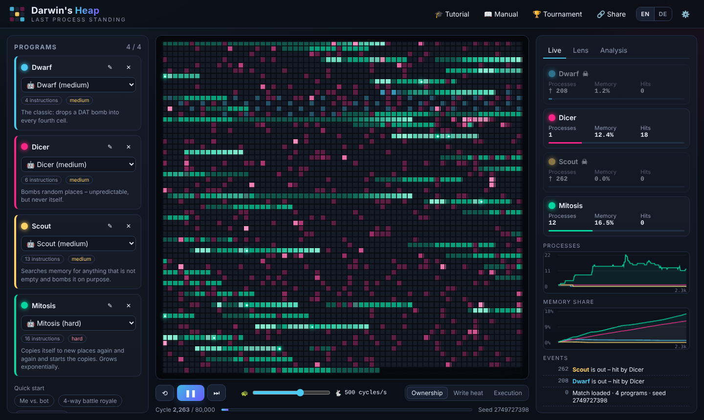

# Darwin's Heap

**Last Process Standing** – ein Browsergame, in dem selbst geschriebene Programme in einem simulierten Speicher gegeneinander antreten. Sie kopieren sich, vermehren sich, legen Fallen und überschreiben sich gegenseitig. Das letzte Programm gewinnt.

🇬🇧 [English version](README.md) (ausführlicher, inklusive Code-Aufbau)



Der Name verbeugt sich vor **Darwin** (1961), dem ersten Spiel dieser Art aus den Bell Labs, und vor **Core War** (1984). „Heap“ ist ein Speicherbereich – und ein Haufen.

Das Spiel gibt es auf **Deutsch und Englisch** (Umschalter `EN | DE` oben rechts; standardmäßig gilt die Sprache des Browsers).

## Spielen

- **Online:** über GitHub Pages unter `https://anotherkarsten.github.io/Darwins-heap/`, sobald Pages aktiviert ist.
- **Lokal:** Repository klonen und im Ordner einen einfachen Webserver starten:

  ```bash
  python3 -m http.server 8080
  # dann http://localhost:8080 öffnen
  ```

  Ein direktes Öffnen von `index.html` per Doppelklick funktioniert nicht, weil Browser JavaScript-Module über `file://` blockieren.

## Was das Spiel kann

- **Arena** mit 2000, 4000 oder 8000 Zellen, bis zu 4 Programme gleichzeitig
- **Darstellung** mit Besitzfarben, aufleuchtenden Schreibzugriffen, Bomben und Prozessen; drei Ansichten (Besitz, Schreib-Hitze, Ausführung)
- **Tempo** von 0,5 bis 30 000 Zyklen pro Sekunde, Pause, Einzelzyklus und Einzelbefehl
- **Statistik, Lupe und Analyse**: Prozesse, Speicheranteil, Treffer-Matrix, Befehlsmix, Verlaufskurven, Ereignisprotokoll
- **Editor** mit Syntaxhervorhebung, Live-Fehlerprüfung, Befehlsreferenz, Vorlagen und `.heap`-Dateien
- **Lernpfad**: *Grundlagen* für absolute Einsteiger – 9 Kapitel mit einem Mini-Speicher aus 32 Zellen. Jede Zelle zeigt A- und B-Feld, ein Klick erklärt eine Zelle Feld für Feld (und markiert, wohin ihre Adressen zeigen), und jeder ausgeführte Befehl wird Zeile für Zeile aufgeschlüsselt: Programmzähler, A-Feld, B-Feld, Ergebnis, neuer PC. Danach 6 Kampf-Lektionen mit Zielen
- **Einzelspieler** gegen 6 Bots (Sitzende Ente, Wichtel, Zwerg, Würfler, Späher, Mitose)
- **Mehrspieler** mit bis zu 4 Programmen an einem Rechner; **🔗 Teilen** erzeugt einen Link mit allen Programmen
- **Turnier** über viele Runden mit Punktetabelle

Die Sprache *Heapcode*, alle Befehle und der Aufbau des Codes sind in der [englischen Beschreibung](README.md) erklärt; das vollständige Handbuch steckt außerdem im Spiel (📖).

## Lizenz

[MIT](LICENSE) © 2026 Karsten Leick
