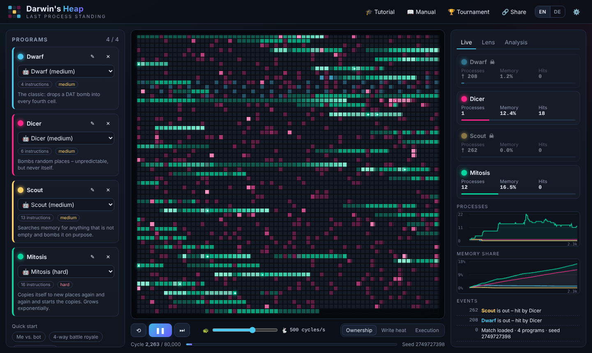

# Darwin's Heap

**Last Process Standing** – ein Browsergame, in dem selbst geschriebene Programme in einem simulierten Speicher gegeneinander antreten. Sie kopieren sich, vermehren sich, legen Fallen und überschreiben sich gegenseitig. Das letzte Programm gewinnt.



Der Name verbeugt sich vor **Darwin** (1961), dem ersten Spiel dieser Art aus den Bell Labs, und vor **Core War** (1984). „Heap“ ist ein Speicherbereich – und ein Haufen.

## Spielen

- **Online:** nach dem ersten Push auf `main` unter `https://anotherkarsten.github.io/Darwins-heap/` (siehe [Veröffentlichen](#veröffentlichen)).
- **Lokal:** Repository klonen und einen beliebigen statischen Webserver im Ordner starten, z. B.

  ```bash
  python3 -m http.server 8080
  # dann http://localhost:8080 öffnen
  ```

  Es gibt keinen Build-Schritt und keine Abhängigkeiten – reines HTML, CSS und JavaScript (ES-Module).

## Was das Spiel kann

| Bereich | Funktionen |
|---|---|
| **Arena** | Ringspeicher mit 2000, 4000 oder 8000 Zellen, bis zu 4 Programme gleichzeitig, faire Reihum-Ausführung, Prozesslimit, Zyklenlimit |
| **Darstellung** | Jede Zelle in der Farbe ihres Besitzers, frische Schreibzugriffe leuchten auf, Bomben (DAT) gedimmt, Prozesse als pulsierende Punkte. Drei Ansichten: *Besitz*, *Schreib-Hitze*, *Ausführung* |
| **Tempo** | 0,5 bis 30 000 Zyklen pro Sekunde oder „Maximum“, Pause, Einzelzyklus (→) und Einzelbefehl (Umschalt + →) |
| **Statistik** | Live-Karten (Prozesse, Speicheranteil, Treffer), Verlaufskurven, Ereignisprotokoll |
| **Lupe** | Disassemblierte Ansicht um jede Zelle, Prozessmarker, „Folgen“-Modus, der an einem Programm klebt |
| **Analyse** | Treffer-Matrix (wer hat wen erwischt), Befehlsmix je Programm, Eigentore, verschlafene Züge u. v. m. |
| **Editor** | Syntaxhervorhebung, Zeilennummern, Fehler live mit Sprung zur Zeile, Befehlsreferenz zum Einfügen, Vorlagen, Datei öffnen/speichern (`.heap`) |
| **Lernpfad** | 6 Lektionen vom ersten `MOV 0, 1` bis zum Battle Royale, mit Zielen und Fortschritt |
| **Einzelspieler** | 6 Bots in drei Stärken: Sitzende Ente, Wichtel, Zwerg, Würfler, Späher, Mitose |
| **Mehrspieler** | Bis zu 4 Programme an einem Rechner. Über **🔗 Teilen** entsteht ein Link, der alle Programme enthält – so schickt jede:r sein Programm an die anderen |
| **Turnier** | Viele Runden mit zufälligen Startpositionen, wahlweise alle gegeneinander oder jeder gegen jeden, Punktetabelle |

Tastenkürzel: `Leertaste` Start/Pause · `→` Schritt · `R` neu starten · `+`/`−` Tempo · `1`–`3` Ansicht · `E` Editor

## Die Sprache: Heapcode

Eine winzige Assemblersprache mit 15 Befehlen, angelehnt an Redcode. Jede Zeile belegt eine Speicherzelle, alle Adressen sind relativ.

```
;name Zwerg
start   ADD #4, bomb      ; Ziel um 4 Zellen weiterschieben
        MOV bomb, @bomb   ; Bombe dorthin kopieren, wohin bomb zeigt
        JMP start
bomb    DAT #0, #0        ; wer das ausführt, stirbt
```

| Befehl | Wirkung |
|---|---|
| `DAT` | Daten. Wer DAT ausführt, stirbt – die klassische Bombe |
| `MOV A, B` | Kopiert Zelle A nach B (mit `#A` nur die Zahl) |
| `ADD`, `SUB` | Rechnen |
| `JMP`, `JMZ`, `JMN`, `DJN` | Springen – immer, bei 0, bei ≠ 0, Zählschleife |
| `SEQ`/`CMP`, `SNE`, `SLT` | Vergleichen und den nächsten Befehl überspringen |
| `SPL A` | **Fortpflanzung:** startet einen weiteren Prozess bei A |
| `WAIT A` | Schläft A eigene Züge – für Timing mit mehreren Prozessen |
| `RND A, B` | Zufallszahl (pro Partie reproduzierbar über den Seed) |
| `NOP` | Nichts tun |

Adressierungsarten: `#` unmittelbar · `$` direkt (Standard) · `@` indirekt · `<` indirekt mit Vor-Dekrement · `>` indirekt mit Nach-Inkrement.
Dazu Labels, `EQU`, `ORG`, Ausdrücke (`+ - * / %`, Klammern) und die Konstante `CORESIZE`. Das vollständige Handbuch steckt im Spiel (📖).

## Aufbau des Codes

```
index.html            Oberfläche
css/style.css         Gestaltung
js/engine/            Spiel-Logik ohne DOM – auch in Node.js lauffähig
  isa.js              Befehlssatz, Beschreibungen, Disassembler
  assembler.js        Übersetzer für Heapcode
  arena.js            Simulation: Speicher, Prozesse, Statistik
  warriors.js         mitgelieferte Bots
  rng.js              reproduzierbarer Zufall
js/ui/                Renderer (Canvas), Editor, Diagramme, Lektionen, Handbuch, Speicher/Teilen
js/main.js            Steuerung der Oberfläche
tests/                Tests mit dem eingebauten Node-Testrunner
```

Die Engine ist vom DOM getrennt. So lassen sich Turniere, Bots und Regeln ohne Browser testen:

```bash
npm test
```

## Veröffentlichen

Zwei GitHub-Actions-Workflows liegen bei:

- **Tests** (`ci.yml`) läuft bei jedem Push und Pull Request.
- **Auf GitHub Pages veröffentlichen** (`pages.yml`) testet und veröffentlicht bei jedem Push auf `main`.

Einmalig nötig: im Repository unter **Settings → Pages → Build and deployment → Source** „**GitHub Actions**“ wählen.

## Ideen für später

- Echter Online-Mehrspieler mit Ranglisten (braucht ein kleines Backend)
- „Hügel“-Modus wie bei Core War: ein dauerhaftes Turnier, in das man Programme einreicht
- Wiedergabe einer Partie als teilbare Aufzeichnung (der Seed macht jede Partie reproduzierbar)
- Englische Oberfläche

## Lizenz

[MIT](LICENSE) © 2026 Karsten Leick
